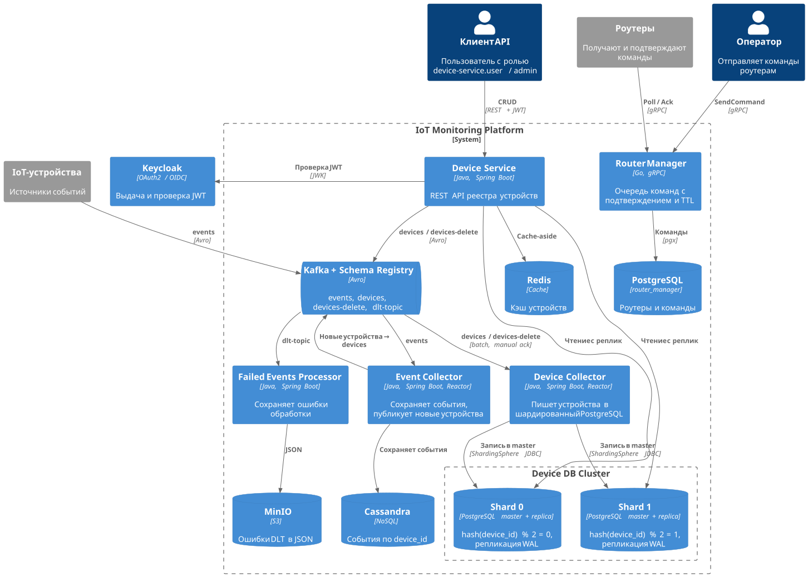

# IoT Monitoring Platform

Микросервисная платформа для приёма событий от IoT-устройств, ведения реестра устройств и отправки команд роутерам.
Сервисы общаются асинхронно через Kafka (Avro + Schema Registry), данные хранятся в шардированном PostgreSQL и
Cassandra, а метрики, логи и трейсы каждого сервиса собираются в Grafana.

**Стек:** Java 24 · Spring Boot 3.5 · Project Reactor · Apache Kafka · Avro · Schema Registry · PostgreSQL 17 · Apache
ShardingSphere · Cassandra 5 · Redis · Keycloak · MinIO · Go 1.24 · gRPC · Docker Compose · Testcontainers ·
Prometheus · Grafana · Loki · Tempo · OpenTelemetry

---

## Архитектура



Обзорная C4-диаграмма показывает сервисы, хранилища и потоки данных.
Исходник: [container-overview.puml](diagrams/container-overview.puml).

**Подробнее:**

- [Полная диаграмма контейнеров](diagrams/container.svg): вместе со стеком наблюдаемости (Prometheus, экспортеры, Alloy,
  Loki, Tempo) и инфраструктурой сборки (Nexus, docker-proxy). Исходник: [container.puml](diagrams/container.puml).
- [Контекстная диаграмма](diagrams/context.puml).
- Компонентные и sequence-диаграммы
  сервисов: [device-service](device-service/diagrams), [device-collector](device-collector/diagrams), [event-collector](event-collector/diagrams), [failed-events-processor](failed-events-processor/diagrams), [router-manager](router-manager/diagrams).

## Сервисы

| Сервис                                             | Язык | Назначение                                                                          |
|----------------------------------------------------|------|-------------------------------------------------------------------------------------|
| [device-service](device-service)                   | Java | REST API реестра устройств: чтение через Redis и реплики, запись через Kafka        |
| [device-collector](device-collector)               | Java | Читает `devices` / `devices-delete` и пишет устройства в шардированный PostgreSQL   |
| [event-collector](event-collector)                 | Java | Сохраняет события в Cassandra и публикует новые устройства в `devices`              |
| [failed-events-processor](failed-events-processor) | Java | Читает `dlt-topic` и сохраняет ошибки обработки в MinIO как JSON                    |
| [router-manager](router-manager)                   | Go   | gRPC-сервис очереди команд для роутеров с подтверждением и TTL                      |
| [avro-shared-library](avro-shared-library)         | Java | Общие Avro-схемы (`DeviceAvro`, `DeviceEventAvro`, `DltError`), публикуются в Nexus |

## Ключевые решения

**Шардирование и репликация PostgreSQL.** Таблица `devices` распределена по двум шардам через ShardingSphere JDBC
(`hash(device_id) % 2`). У каждого шарда есть master и потоковая реплика (WAL). Чтение балансируется round robin, запись
идёт только в master.

**Запись через Kafka (CQRS-подход).** `device-service` не пишет в базу напрямую. Создание, изменение и удаление
публикуются в Kafka, API отвечает `202 Accepted`. В базу пишет `device-collector`. Чтение идёт по схеме cache-aside:
сначала Redis, потом реплики шардов. При изменении запись в кэше инвалидируется.

**Порядок и параллелизм при обработке батчей.** `device-collector` читает Kafka батчами (до 100 записей, 4 потребителя,
ручной коммит offset, CooperativeStickyAssignor). Внутри батча записи группируются по `deviceId`: изменения одного
устройства применяются строго по порядку, разные устройства обрабатываются параллельно (до 8 групп).

**Ретраи и Dead Letter Topic.** При ошибке выполняется 3 повтора с экспоненциальной задержкой (1 → 8 с), после чего
сообщение уходит в `dlt-topic` вместе с причиной, стектрейсом и `traceId`. `failed-events-processor` сохраняет такие
ошибки в MinIO для разбора. Продюсеры работают с `acks=all` и идемпотентностью. Схемы не регистрируются автоматически:
контракт управляется через Schema Registry.

**Дедупликация устройств в event-collector.** Чтобы не публиковать одно и то же устройство на каждое событие,
используется Bloom-фильтр (1 млн элементов, 1% ложноположительных срабатываний). При старте он прогревается из
Cassandra. События хранятся в таблице с партицией по `device_id` и сортировкой по времени (новые первыми), чтобы история
одного устройства читалась одним запросом.

**Очередь команд в router-manager.** Команды проходят состояния `PENDING → SENT → ACKED`. Если команда не подтверждена
за TTL, фоновый воркер переводит её в `FAILED`. `Poll` в одной транзакции отмечает активность роутера, выбирает до 100
команд в порядке FIFO и переводит их в `SENT`. Broadcast всем роутерам записывается одной пачкой через `COPY`. Доменные
ошибки маппятся в gRPC-коды (`InvalidArgument`, `NotFound`, `FailedPrecondition`).

**Безопасность.** `device-service` выступает как OAuth2 Resource Server с JWT от Keycloak. Изменять устройства может
роль `device-service.admin`, читать могут `device-service.user` и `device-service.admin`. Эндпоинт
`/actuator/prometheus` закрыт отдельным токеном.

**API.** Контракт `device-service` описан в [OpenAPI](device-service/openapi/device-service-api.yaml). Из него
генерируются серверные интерфейсы и Feign-клиент, который публикуется в Nexus как отдельный артефакт.

## Наблюдаемость

- **Метрики:** Prometheus собирает данные с Actuator сервисов, экспортеров PostgreSQL, Kafka и Redis, а также JMX
  Cassandra и Schema Registry. Бизнес-метрики (успехи и ошибки операций, попадания в кэш) собираются через собственные
  AOP-аннотации.
- **Трейсы:** OpenTelemetry → Alloy → Tempo, `trace_id` передаётся через заголовки Kafka.
- **Логи:** JSON-логи (logstash encoder) → Alloy → Loki.
- **Дашборды:** 11 преднастроенных дашбордов Grafana: по каждому сервису, Kafka, Schema Registry, Cassandra и базам
  PostgreSQL.

## Тестирование

- Unit-тесты на JUnit 5 и Mockito.
- Интеграционные тесты на Testcontainers (Kafka, Schema Registry, PostgreSQL, Cassandra, Keycloak и др.).
- Тесты запускаются при сборке Docker-образа. Чтобы Testcontainers работали внутри сборки, сокет Docker пробрасывается
  через socat-прокси.
- Для router-manager есть unit- и интеграционные тесты на Go (`testcontainers-go`).

## Запуск

Нужны Docker, Docker Compose и GNU Make.

```bash
git clone https://github.com/SinglePlayer56/iot.git
cd iot
cp .env.example .env

make nexus-start              # локальный Nexus для общих артефактов
make build-all-artifacts      # публикация Avro-схем и API-клиента в Nexus
make infra                    # Kafka, БД, Keycloak, MinIO, мониторинг
```

Перед первой отправкой сообщений зарегистрируйте Avro-схемы в Schema Registry через Kafka UI: `devices-value`,
`devices-delete-value`, `events-value`, `dlt-topic-value`. Схемы приведены в README сервисов.

Сервисы запускаются по отдельности. Ключ `-build` пересобирает образ и прогоняет тесты:

```bash
make device-collector-start-build
make device-service-start-build
make event-collector-start-build
make failed-events-processor-start-build
make router-manager-start-build
```

У каждого сервиса есть вариант `*-monitoring-start-build`, который поднимает вместе с ним стек мониторинга. Подробности
запуска, примеры сообщений и переменные окружения описаны в README сервисов.

| UI                 | Адрес                 |
|--------------------|-----------------------|
| Grafana            | http://localhost:3000 |
| Kafka UI           | http://localhost:8070 |
| Keycloak           | http://localhost:8080 |
| MinIO Console      | http://localhost:9001 |
| Prometheus         | http://localhost:9090 |
| Device Service API | http://localhost:8203 |

---

Проект выполнен в рамках курса «Высоконагруженные распределённые системы» (НашКод).